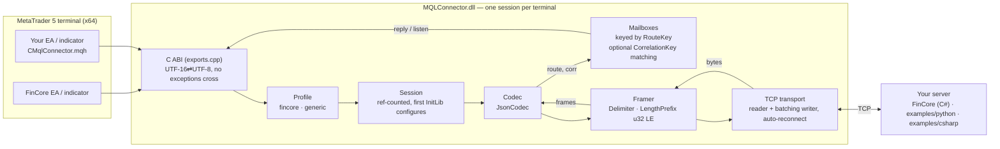

# MQLConnector

[](https://github.com/sergiovision/MQLConnector/actions/workflows/ci.yml)


**A low-latency C++20 messaging library that connects MetaTrader 5 trading programs to any TCP
server.** It takes a request from an MQL5 program to the server and back in **about 65 µs (p50)**
over loopback. The .NET connector it replaced could not answer in less than **50–300 ms**, so this is
an improvement of about three orders of magnitude. It ships as one dependency-free x64 DLL. It was built for the
[FinCore](https://github.com/sergiovision) trading platform and works with any server that follows
[docs/PROTOCOL.md](docs/PROTOCOL.md).

> **For reviewers in a hurry:** the [engineering highlights](#engineering-highlights) table maps each
> part of the code to the skill it shows. [docs/DESIGN.md](docs/DESIGN.md) covers the threading model,
> the memory-ownership rules and the hot path in depth.

---

## At a glance

| | |
|---|---|
| **Language / build** | C++20, CMake + Ninja, MSVC v143 (`/W4 /WX /permissive-`), clang (`-Wall -Wextra -Wpedantic -Werror`) |
| **Latency** | 64 B request → reply: **p50 65 µs, p99 260 µs**; 4 KiB: p50 90 µs, p99 286 µs (loopback, Release) |
| **Hot path** | One parse per frame without building a DOM; the frame is a view into the read buffer when it arrives whole; `memchr` scans for the delimiter; no per-byte virtual calls |
| **Concurrency** | Reader thread + batching writer thread + async logger; every shared member has one owner and one lock; shutdown is bounded through `std::stop_token` |
| **Networking** | Its own TCP transport (Winsock / POSIX sockets), `TCP_NODELAY`, reconnect with backoff, two framings (delimiter, u32 LE length prefix) |
| **ABI** | Frozen `extern "C"` surface, no exception crosses it, no `DllMain`, nothing runs under the loader lock, static CRT, only system DLLs imported |
| **Portability** | Everything below the ABI shim is platform-neutral; CI builds and tests on **Windows, Linux and macOS** |
| **Verification** | GoogleTest suites (unit, loopback integration, golden-frame compatibility, DLL-load), a latency benchmark, and a CI check of the DLL's exports and imports |

## Engineering highlights

| Skill area | Where to look | What it demonstrates |
|---|---|---|
| **Low-latency design** | [`src/connector/session.cpp`](src/connector/session.cpp), [`src/core/mailbox.cpp`](src/core/mailbox.cpp) | A reply wakes the waiting caller directly through a condition variable instead of a sleep-and-poll loop. Routing is per-mailbox, so callers never contend on one global lock. |
| **Allocation-free parsing** | [`src/core/signal_json.cpp`](src/core/signal_json.cpp) | A validating JSON reader that returns source slices for the top-level keys it needs. It skips nested data of any depth (up to 4096) with a bit stack, without recursion or heap allocation. |
| **Zero-copy framing** | [`src/core/framer.{h,cpp}`](src/core/framer.h) | A streaming framer interface with delimiter and length-prefix implementations. A frame that arrives in one read is a view into the read buffer. The length prefix is encoded explicitly as little-endian, so it is endian-safe. |
| **Network programming** | [`src/net/`](src/net) | RAII sockets for Winsock and POSIX (`MSG_NOSIGNAL` / `SO_NOSIGPIPE`), connects sliced into 50 ms steps so they can be interrupted, a write-batching writer thread (one `send` per burst) and automatic reconnects. |
| **Concurrency correctness** | [`src/core/mailbox.h`](src/core/mailbox.h), [`src/net/tcp_transport.cpp`](src/net/tcp_transport.cpp) | One lock per component. No lock is held across a socket call or a callback. `std::jthread` + `std::stop_token` make every wait interruptible. Correlated waits use `notify_all` only where several waiters can be woken. |
| **Systems / OS internals** | [`src/exports.cpp`](src/exports.cpp) | Loader-lock-safe DLL design: the module pins itself while its threads run, the process-wide session is never destroyed (`NoDestructor`), and the code respects the static CRT's thread-detach rules. |
| **Protocol design** | [`src/core/codec.h`](src/core/codec.h), [docs/PROTOCOL.md](docs/PROTOCOL.md) | Pluggable `Framer`/`Codec` layers, configurable routing keys and opt-in request/reply correlation. The wire format leaves room for a binary (FBE) encoding. |
| **Benchmarking** | [`bench/roundtrip_bench.cpp`](bench/roundtrip_bench.cpp) | Reports p50/p99/p99.9 and throughput against an in-process server, for both framings and with or without correlation. Changes are measured before any speed-up is claimed. |
| **Backward compatibility** | [`tests/fincore_compat_test.cpp`](tests/fincore_compat_test.cpp) | Golden-frame tests check that refactors keep the bytes on the wire and the strings returned to callers identical. |

## Architecture



**Request path.** An MQL call → `exports.cpp` (UTF-16 → UTF-8, catch-all) → `Session::request` →
the writer thread's queue → one batched `send`. **Reply path.** The reader thread → `Framer` splits
the bytes → `Codec` reads the route and correlation values in a single pass → the mailbox for that
route → the waiting caller is woken. Details, invariants and ownership rules:
[docs/DESIGN.md](docs/DESIGN.md).

## Performance

`mqlc_bench`: Release build, Windows 11 x64, loopback, a session round trip against an in-process
echo server:

| Payload | Round trips | p50 | p99 | p99.9 | Throughput |
|---|---|---|---|---|---|
| 64 B | 10 000 | 65 µs | 260 µs | 736 µs | 12 600 /s |
| 4 KiB | 2 000 | 90 µs | 286 µs | 779 µs | 9 500 /s |

The .NET connector this replaces sent a request, slept for `WaitOp` and only then checked for a reply.
Its round trip therefore had a floor of one `WaitOp` plus a timer tick: 50–62 ms in the strategy
tester and 300–312 ms on live charts. That floor follows from its code; this benchmark did not
measure it.

```sh
mqlc_bench --n 10000                         # 64 B, 0x1A-delimited JSON
mqlc_bench --n 2000 --payload 4096
mqlc_bench --n 10000 --framing length        # u32 LE length prefix
mqlc_bench --n 10000 --corr 1                # request/reply correlation on
```

Most of the remaining latency is the OS: two loopback TCP hops plus a condition-variable wake-up on
each side. [Where the remaining microseconds go](#where-the-remaining-microseconds-go) lists the next
steps, each of which would be measured before it is adopted.

## Quickstart (MT5 + your own server)

1. Build the DLL (see [Building](#building)), or take the `MQLConnector` artifact from a green CI run.
2. Copy `MQLConnector.dll` to `MQL5\Libraries\` and the `mql/Include` tree to `MQL5\Include\`.
3. In MT5, enable **Tools → Options → Expert Advisors → Allow DLL imports**.
4. Start a reference server: `python examples/python/server.py` (standard library only) or
   `dotnet run --project examples/csharp`.
5. Attach [`mql/Experts/MQLConnectorExample.mq5`](mql/Experts/MQLConnectorExample.mq5) to a chart.
   The Experts log shows the round trips.

```mql5
#include <MQLConnector/CMqlConnector.mqh>

CMqlConnector conn;
conn.Open("127.0.0.1", 2023, ChartID(), "\"Profile\":\"generic\",\"CorrelationKey\":\"ReqId\"");
string reply = conn.Request("{\"ChartId\":" + (string)ChartID() + ",\"ReqId\":7,\"Op\":\"ping\"}");
string push  = conn.Poll();      // frames the server pushed to this chart
```

## The C ABI

```mql5
#import "MQLConnector.dll"
int    InitLib(string json);                     // 1 connected, 0 not (yet)
void   DestroyLib(long chartId);
string DoSendMessage(string json);               // send, wait up to WaitTimeout for the reply
void   DoPostMessage(string json);               // send, don't wait
string DoListenMessage(long key);                // next queued frame for a route, or ""
string GetLevels(string sym, long chartId);      // fincore profile only
string GetSignalCache(string key, string sym, long chartId);  // fincore profile only
string GetVersion();                             // "1.1.0"
#import
```

| Export | Semantics |
|---|---|
| `InitLib` | Process-wide, ref-counted session. The first call configures it (see the keys below) and connects, waiting up to `WaitTimeout`. Each call adds a reference and subscribes its route. |
| `DestroyLib` | Unsubscribes the route and drops a reference. The last reference stops the connection within a bounded time. |
| `DoSendMessage` | Sends, then blocks on the route's mailbox for up to `WaitTimeout`. It returns the first frame, or the first frame with a matching correlation value when `CorrelationKey` is set. On timeout it returns `""`. |
| `DoPostMessage` | Queues the frame for the writer thread and returns at once. It never blocks MQL on the socket. |
| `DoListenMessage` | Non-blocking dequeue from a route's mailbox. |
| `GetLevels`, `GetSignalCache` | FinCore helpers. In the `generic` profile they return `""`. |
| `GetVersion` | The library version (CMake `PROJECT_VERSION`). |

The returned strings live in a per-thread, per-function buffer until the next call of the same
function on the same thread. MT5 copies them immediately.

### `InitLib` keys

Values may be strings or numbers. An invalid value logs a warning and the default is used; it never
makes the call fail. The first `InitLib` in a terminal configures the session. Later calls with
different values log which keys they ignored.

| Key | Type | Default | Meaning |
|---|---|---|---|
| `Host` / `Port` | string / int | `127.0.0.1` / `2022` | Server address |
| `ChartId` | int64 | `0` | The route this caller subscribes |
| `WaitTimeout` | ms | `3000` | Reply and reconnect budget |
| `Profile` | `fincore` \| `generic` | `fincore` | `generic` skips the FinCore log-path handshake and the FinCore signal ids |
| `RouteKey` | string | `ChartId` | Top-level member that routes an incoming frame to a mailbox |
| `CorrelationKey` | string | *(off)* | When set, `DoSendMessage` returns only the reply whose member equals the request's |
| `Framing` | `delimiter` \| `length` | `delimiter` | `length` = u32 little-endian total length (includes the 4-byte prefix) |
| `Delimiter` | int 1–31 | `26` (`0x1A`) | The delimiter byte when `Framing` is `delimiter` |
| `LogPath` / `LogLevel` | path / `off`\|`error`\|`info` | `%TEMP%\MQLConnector.log` / `info` | Asynchronous, non-blocking logger |
| `Protocol` | `tcp` | `tcp` | `fbe` is reserved; for now it falls back to `tcp` with a warning |
| `Account`, `WaitOp` | | | Accepted for FinCore compatibility |

## Repository layout

```
include/mqlconnector/      Public C ABI header
src/exports.cpp            ABI shims: UTF-16 <-> UTF-8, catch-all, module pin    (Windows only)
src/connector/             Session: config, transport, mailboxes, profile, logger
src/core/                  Platform-neutral core: framer, codec, JSON reader/writer, mailboxes,
                           config, async logger, UTF conversion
src/net/                   Transport interface, TCP reader/writer threads, Winsock + POSIX sockets
src/profiles/              fincore (handshake, FinCore helpers) and generic profiles
tests/                     GoogleTest: unit, loopback integration, golden frames, DLL load
bench/                     mqlc_bench round-trip latency benchmark
tools/echo_server/         Loopback server for tests, the benchmark and the MT5-side benchmark
examples/python, csharp/   Reference servers (asyncio / NetCoreServer), both framings
mql/                       MQL5 import header, CMqlConnector wrapper, example EA, benchmark script
docs/                      DESIGN.md (internals), PROTOCOL.md (wire format, for server authors)
.github/                   CI: Windows (DLL, tests, export/import check), Linux, macOS
```

## Building

Requirements: CMake ≥ 3.25, Ninja and a C++20 compiler with `std::jthread`. On Windows that is
MSVC v143 (VS 2022) run from an x64 developer prompt. On Linux it is clang 16+ or GCC 13+. On macOS it
is Xcode 16.3+ or Homebrew LLVM 18+.

```sh
# Windows: the DLL, all tests, the benchmark
cmake --preset windows-x64-release && cmake --build --preset windows-x64-release && ctest --preset windows-x64-release

# Linux / macOS: the platform-neutral core, transport and session, with their tests and the benchmark
cmake --preset linux-dev && cmake --build --preset linux-dev && ctest --preset linux-dev
cmake --preset macos-dev && cmake --build --preset macos-dev && ctest --preset macos-dev
```

`build.bat` configures, builds and tests in one step. Release builds use
`/O2 /GL /LTCG /MT`. GoogleTest is fetched for the tests only. If a MinGW/MSYS2 `cmake` fails to
download it ("certificate signer not trusted"), pass `-DCMAKE_TLS_CAINFO=<bundle>` or
`-DFETCHCONTENT_SOURCE_DIR_GOOGLETEST=<dir>`.

Check a Windows build (CI runs this check):

```powershell
./.github/scripts/check-dll.ps1 build/windows-x64-release/MQLConnector.dll   # 8 exports, system DLLs only
```

## Tests

`mqlc_tests` runs on all platforms:

- **Framers:** headers and frames split across reads, many frames coalesced into one read, oversized
  or undersized length prefixes (the connection is reset, then resumes cleanly), UTF-8 cut across
  reads, delimiter escaping inside and outside JSON strings.
- **JSON / codec:** escapes, nested data, numbers vs strings, missing keys, garbage input, the depth
  limit, route and correlation extraction.
- **Mailboxes:** timeout accuracy, routing, unsubscribed drops, overflow, correlated matching with 8
  concurrent waiters on one route.
- **Transport and session against an in-process loopback server:** round trips for both framings;
  broadcasts routed only to the subscribed route; 8 routes on 8 threads with no cross-delivery;
  timeouts return within `WaitTimeout` ± 20 ms; the server restarts and the client reconnects;
  `DoPostMessage` never blocks while the server stops reading.
- **FinCore golden frames:** the exact bytes on the wire and the exact strings returned to MQL for
  every FinCore call shape.

`mqlc_dll_tests` (Windows) loads the built DLL with `LoadLibraryW` and calls all 8 exports through
`GetProcAddress`.

## Why C++

C++ is where my professional career started, about twenty years ago, and it is still my favourite
language. I still use it wherever speed and memory matter most: when a hot path decides how fast a
whole application feels, I write that part as a small native library in C++, the way I wrote this one.
The applications that load such a library get much faster and use less memory without being
rewritten. Here a request that used to wait at least 50 ms in the strategy tester (300 ms on live
charts) now completes in about 65 µs, and the old runtime dependencies are gone.

AI tools make this kind of optimisation faster to do, but they do not replace knowing how C++ works.
Getting the most out of it still depends on that knowledge:

- **Ownership and lifetimes.** RAII throughout and no raw `new`/`delete`; strings and buffers are
  views until a copy is really needed.
- **The memory model.** Every piece of state shared between threads has one documented owner and
  one lock. Threads stop through `std::stop_token`, and each blocking call can be interrupted, so
  shutdown time is bounded.
- **The ABI and the loader.** No exception crosses `extern "C"`. Nothing runs under the loader lock.
  The module is pinned while its threads run, and the static CRT keeps it a single file.
- **Allocation-conscious parsing.** The JSON reader validates a frame and skips nested data of any
  depth without recursion or heap allocation. The framer hands out views into the read buffer when a
  frame arrives in one piece.
- **Measuring rather than guessing.** Latency claims come from the benchmark above, and behaviour is
  covered by unit and integration tests that also run on Linux and macOS.

## Where the remaining microseconds go

At 65 µs most of the time is spent in the kernel: two loopback TCP traversals and two thread
wake-ups. Next steps, ordered by expected gain. Each would be benchmarked before it is adopted:

1. **Spin-then-block waits.** Spin briefly on an atomic sequence number before parking on the
   condition variable. This removes the scheduler wake-up from the common case, at the cost of CPU.
2. **Busy-polling reader on Linux.** `SO_BUSY_POLL` / `epoll` busy-poll with the reader pinned to an
   isolated core (`isolcpus`, `sched_setaffinity`), so it never sleeps in the kernel.
3. **A lock-free SPSC ring** between the API thread and the writer, replacing the mutex-guarded queue.
4. **A binary encoding (FBE).** The `Codec`/`Framer` split and the u32 LE length framing exist so that
   Fast Binary Encoding can replace JSON without changing the transport.
5. **Kernel bypass** (for example, Solarflare/OpenOnload) for co-located deployments. The transport
   interface isolates the socket layer, so this can be added without touching the session.

## Limitations

- **One session per terminal process.** The first `InitLib` configures it. A FinCore EA and a generic
  EA in the same terminal share that one connection and its settings.
- With correlation on, an unmatched backlog can fill a mailbox (the oldest entry is dropped first), so
  drain unsolicited frames with `DoListenMessage`.
- The DLL is for MetaTrader 5, x64 only. The core library builds and is tested on Linux and macOS.

## License

MIT. See [LICENSE](LICENSE).
